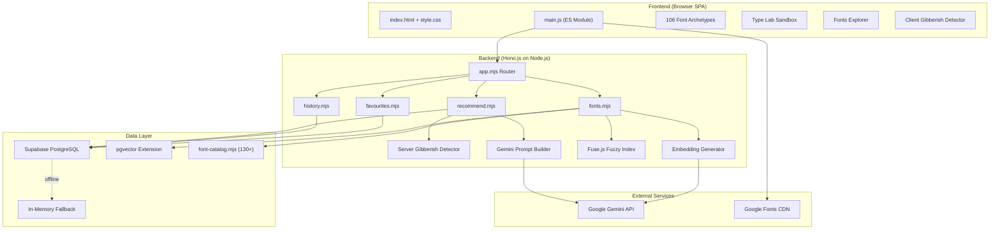
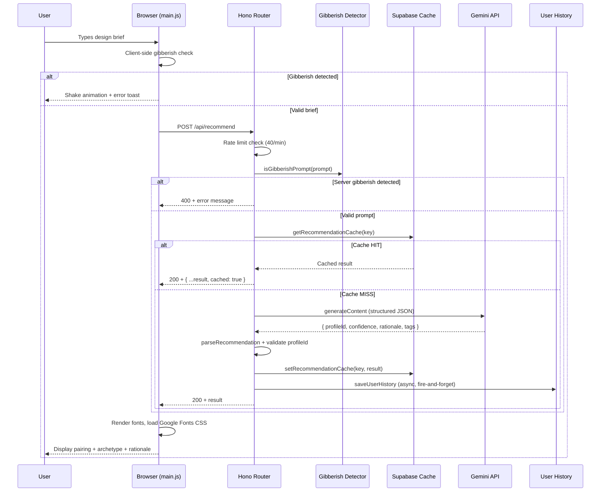
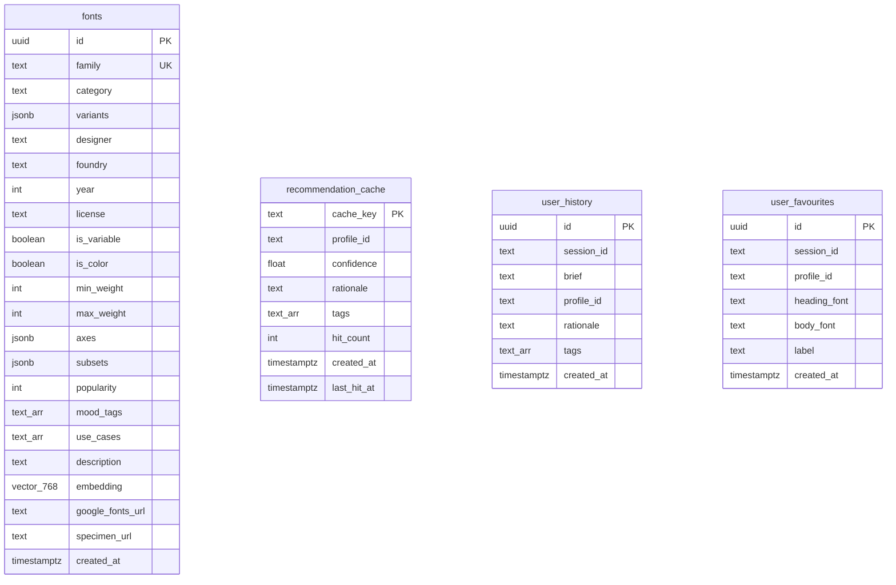
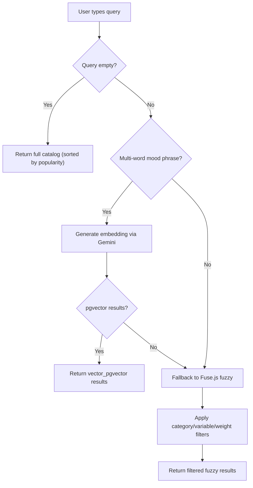
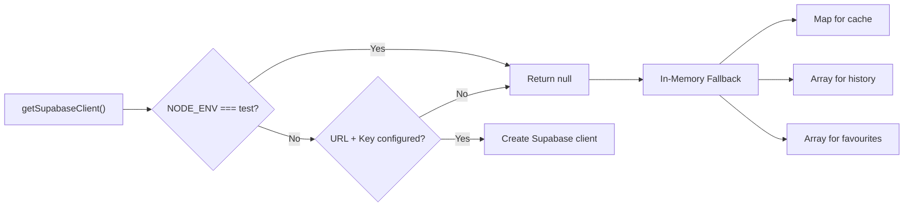

<div align="center">

# **FONTALLY — Architecture Document**

### *Complete System Architecture, Features & Technical Reference*

**Version 1.0** · **October 2026**

---

*An intelligent brief-to-type pairing engine & typography playground*

</div>

---

## Table of Contents

1. [Executive Summary](#1-executive-summary)
2. [System Overview](#2-system-overview)
3. [Tech Stack](#3-tech-stack)
4. [Project Structure](#4-project-structure)
5. [Architecture Diagrams](#5-architecture-diagrams)
6. [Frontend Architecture](#6-frontend-architecture)
7. [Backend Architecture](#7-backend-architecture)
8. [AI & Machine Learning Pipeline](#8-ai--machine-learning-pipeline)
9. [Database Architecture](#9-database-architecture)
10. [API Reference](#10-api-reference)
11. [Search Architecture](#11-search-architecture)
12. [Caching Strategy](#12-caching-strategy)
13. [Security Model](#13-security-model)
14. [Deployment Architecture](#14-deployment-architecture)
15. [Testing Strategy](#15-testing-strategy)
16. [Data Flow Diagrams](#16-data-flow-diagrams)
17. [Feature Catalog](#17-feature-catalog)
18. [Configuration Reference](#18-configuration-reference)
19. [Performance Characteristics](#19-performance-characteristics)

---

## 1. Executive Summary

**Fontally** is a full-stack web application that translates natural-language design briefs into curated typography systems. Instead of browsing font galleries by name or category, users describe their project's mood, audience, or aesthetic in plain English, and Fontally's AI engine returns the perfect headline + body font pairing with a creative rationale.

### Core Value Proposition

| Traditional Font Selection | Fontally |
|---|---|
| Browse 1,500+ fonts by name | Describe a vibe in natural language |
| Filter by category manually | AI understands creative intent |
| Trial-and-error pairing | Instant curated heading + body pair |
| No context-aware suggestions | Rationale explains *why* the pairing works |

### Key Metrics

| Metric | Value |
|---|---|
| Font Archetypes | 106+ curated profiles |
| Enriched Font Catalog | 130+ fonts with metadata |
| Vector Embedding Dimensions | 768 (Gemini) |
| Gibberish Detection Patterns | 8 heuristic layers |
| API Response (cached) | <1ms |
| API Response (Gemini) | ~2–4s |
| Test Coverage | 2 test suites, 15+ assertions |

---

## 2. System Overview

Fontally follows a **monorepo, full-stack JavaScript** architecture with a clear separation between the client-side SPA and the server-side API layer. Both share a single codebase and can be developed, tested, and deployed as one unit.

```
┌─────────────────────────────────────────────────────────────────┐
│                        USER (Browser)                          │
│  ┌──────────┐  ┌──────────────┐  ┌───────────────────────┐     │
│  │ Design   │  │ Type Lab     │  │ Google Fonts Explorer │     │
│  │ Brief    │  │ Sandbox      │  │ (Fuzzy + Semantic)    │     │
│  └────┬─────┘  └──────────────┘  └───────────────────────┘     │
│       │                                                         │
│       ▼                                                         │
│  ┌──────────────────────────────────────────────────────────┐   │
│  │            Vanilla JavaScript SPA (main.js)              │   │
│  │  • 106 Profile Archetypes  • Gibberish Detector (Client)│   │
│  │  • CSS Export Generator    • Session Management          │   │
│  └─────────────────────────┬────────────────────────────────┘   │
└────────────────────────────┼────────────────────────────────────┘
                             │  HTTP / JSON
                             ▼
┌─────────────────────────────────────────────────────────────────┐
│                   Hono.js API Router (app.mjs)                  │
│  ┌──────────┐ ┌──────────┐ ┌──────────┐ ┌────────────────┐     │
│  │/recommend│ │ /fonts   │ │/history  │ │  /favourites   │     │
│  └────┬─────┘ └────┬─────┘ └────┬─────┘ └───────┬────────┘     │
│       │             │            │                │              │
│  ┌────▼─────┐  ┌────▼─────┐  ┌──▼────────────────▼──────────┐  │
│  │ Gemini   │  │ Fuse.js  │  │   Supabase Client (DB Layer) │  │
│  │ API Call │  │ Fuzzy    │  │   with in-memory fallback     │  │
│  └────┬─────┘  │ Index    │  └──────────────┬────────────────┘  │
│       │        └──────────┘                  │                   │
└───────┼──────────────────────────────────────┼───────────────────┘
        │                                      │
        ▼                                      ▼
┌───────────────┐                 ┌──────────────────────────┐
│  Google       │                 │  Supabase PostgreSQL     │
│  Gemini API   │                 │  + pgvector Extension    │
│  • gemini-    │                 │  ┌─────────┐             │
│    2.5-flash  │                 │  │ fonts   │ (130+ rows) │
│  • embedding  │                 │  │ cache   │ (rec cache) │
│    -001       │                 │  │ history │ (sessions)  │
└───────────────┘                 │  │ favs    │ (bookmarks) │
                                  │  └─────────┘             │
                                  └──────────────────────────┘
```

---

## 3. Tech Stack

### Frontend

| Technology | Purpose | Version |
|---|---|---|
| **HTML5** | Semantic document structure | — |
| **Vanilla CSS** | Design system, dark mode, responsive layout, animations | — |
| **Vanilla JavaScript (ES Modules)** | Client SPA logic, DOM manipulation, state management | ES2022+ |
| **Google Fonts API** | Dynamic font loading via `@import` | v2 CSS API |
| **Vite** | Development server, HMR, production bundler | 7.x |

### Backend

| Technology | Purpose | Version |
|---|---|---|
| **Hono.js** | Ultralight web framework / API router | 4.x |
| **Node.js** | JavaScript runtime | 20.18+ / 22.x |
| **Fuse.js** | Typo-tolerant fuzzy search engine | 7.x |
| **Supabase JS Client** | PostgreSQL database driver | 2.x |

### AI & Embeddings

| Technology | Purpose | Model |
|---|---|---|
| **Google Gemini API** | Natural-language font recommendation | `gemini-2.5-flash` |
| **Gemini Embedding API** | 768-dimensional vector embeddings for semantic search | `gemini-embedding-001` |

### Database

| Technology | Purpose |
|---|---|
| **Supabase (PostgreSQL)** | Persistent relational database |
| **pgvector** | Vector similarity search extension |
| **Row Level Security (RLS)** | Access control policies |

### Testing & CI

| Technology | Purpose | Version |
|---|---|---|
| **Vitest** | Unit & integration test runner | 4.x |
| **jsdom** | DOM simulation for frontend tests | 30.x |

### Deployment

| Technology | Purpose |
|---|---|
| **Vercel** | Serverless hosting, edge functions, CDN |
| **Vercel Serverless Functions** | API route handlers (`api/*.js`) |

---

## 4. Project Structure

```
Fontally/
├── api/                              # Vercel Serverless Function entrypoints
│   ├── index.js                      # Hono catch-all handler (production)
│   ├── recommend.js                  # POST /api/recommend
│   ├── fonts.js                      # GET /api/fonts, /api/fonts/similar/:family
│   ├── history.js                    # GET/POST /api/history
│   ├── favourites.js                 # GET/POST/DELETE /api/favourites
│   └── health.js                     # GET /api/health
│
├── server/                           # Backend application code
│   ├── app.mjs                       # Hono router: CORS, timing, error handling, sub-routes
│   ├── gemini-recommendation.mjs     # Gemini prompt builder, JSON schema, gibberish detector
│   ├── google-fonts.mjs              # Google Fonts API integration handler
│   │
│   ├── db/
│   │   ├── schema.sql                # PostgreSQL + pgvector DDL, indexes, RLS policies
│   │   ├── seed.sql                  # 130+ font INSERT statements with ON CONFLICT
│   │   └── supabase.mjs             # Supabase client, cache layer, in-memory fallback
│   │
│   ├── lib/
│   │   ├── font-catalog.mjs         # 130+ enriched font definitions (ENRICHED_FONT_CATALOG)
│   │   ├── embeddings.mjs           # Gemini embedding-001 vector generator + cosine similarity
│   │   └── fuzzy.mjs                # Fuse.js multi-key search index factory
│   │
│   └── routes/
│       ├── recommend.mjs            # POST /api/recommend (Hono sub-router)
│       ├── fonts.mjs                # GET /api/fonts, /api/fonts/similar/:family
│       ├── history.mjs              # GET/POST /api/history
│       └── favourites.mjs           # GET/POST/DELETE /api/favourites
│
├── src/                              # Frontend source
│   ├── main.js                       # Client SPA: profiles, Type Lab, search, gibberish detector
│   └── style.css                     # Design system: dark mode, gradients, animations
│
├── scripts/
│   └── seed-fonts.mjs               # Node.js seeder with Gemini vector embedding generation
│
├── tests/
│   ├── backend.test.js              # Vitest: Hono routes, search, filters, validation
│   └── scorer.test.js               # Vitest: Gemini response parsing, gibberish detection
│
├── index.html                        # SPA entry point
├── package.json                      # Dependencies & scripts
├── vite.config.js                    # Vite dev server + Hono API middleware plugin
├── vercel.json                       # Vercel deployment configuration
├── .env.example                      # Environment variable template
└── .gitignore                        # Git ignore rules (includes .env)
```

### File Size Breakdown

| File | Lines | Purpose |
|---|---|---|
| `src/main.js` | 2,643 | Client-side SPA (profiles, Type Lab, search UI) |
| `src/style.css` | 641 | Complete dark-mode design system |
| `index.html` | 219 | Semantic HTML structure |
| `server/gemini-recommendation.mjs` | 386 | Gemini integration + gibberish detector |
| `server/db/supabase.mjs` | 289 | Database abstraction layer |
| `server/routes/fonts.mjs` | 203 | Font search & similarity engine |
| `server/db/schema.sql` | 180 | Database schema + stored procedures |
| `tests/backend.test.js` | 180 | Backend API test suite |
| `tests/scorer.test.js` | 164 | Recommendation & validation tests |

---

## 5. Architecture Diagrams

### 5.1 High-Level Component Diagram



### 5.2 Request Lifecycle (Recommendation Flow)



---

## 6. Frontend Architecture

### 6.1 Design Philosophy

The frontend is a **zero-framework, vanilla JavaScript SPA** — no React, no Vue, no build-time templating. All DOM manipulation is done through direct `querySelector` calls and imperative updates. This was a deliberate architectural decision for:

- **Zero bundle overhead** — no framework runtime shipped to the client
- **Full control** over animations, transitions, and rendering
- **Simplicity** — single file, no component tree, no state management library

### 6.2 Module Structure (`main.js` — 2,643 lines)

```
main.js
├── UI Element Handles          (Lines 1–44)     # querySelector bindings
├── Font Archetype Profiles     (Lines 48–1800+) # 106 profile definitions
├── Gibberish Detection         (Client-side)    # Pre-flight input validation
├── Design Brief Handler        (analyse click)  # POST /api/recommend
├── Font Rendering Engine       (loadFonts)      # Google Fonts CSS injection
├── Type Lab Sandbox            (specimen*)      # Interactive type tester
│   ├── Font Size Slider        (20–120px)
│   ├── Style Modifiers         (Uppercase, Italic, Bold)
│   ├── Color Palette Swatches  (8 colors + custom picker)
│   └── Dummy Copy Presets      (Pangram, Headline, Alphabet, etc.)
├── CSS Export Generator        (copyCss)        # @import + custom properties
├── Google Fonts Explorer       (fontSearch*)     # Live search + filters
│   ├── Fuzzy Search UI         (debounced input)
│   ├── Category Filter Chips   (sans-serif, serif, display, mono, hand)
│   └── Font Cards Renderer     (scrollable results list)
├── History & Favourites UI     (session-based)
└── Toast Notification System   (success/error feedback)
```

### 6.3 Font Archetype Profile Schema

Each of the 106 profiles is a JavaScript object with the following shape:

```javascript
{
  id: 'fintech',                               // Unique profile identifier
  words: ['fintech', 'wealth', 'bank', ...],   // Keyword trigger vocabulary
  name: 'PP Neue Montreal',                    // Display font name
  sample: 'PP Neue<br/><i>Montreal</i>',       // HTML-formatted specimen
  meta: 'GROTESK / VARIABLE',                  // Classification badge
  pair: 'ABC Arizona Flare',                   // Recommended body font
  pairMeta: 'SERIF / 20PX',                    // Body font classification
  rationale: 'A calm, precision-first...',     // Creative explanation
  archetype: 'THE OPTIMISTIC OPERATOR',        // Personality label
  headingFallback: "'Plus Jakarta Sans'...",    // Google Fonts CSS fallback
  bodyFallback: "'Playfair Display'...",        // Google Fonts CSS fallback
  googleFontsUrl: 'https://fonts.googleapis...' // @import URL
}
```

### 6.4 Client-Side Gibberish Detection

The client performs a **pre-flight** gibberish check before sending the request to the server. This provides instant feedback with a CSS shake animation and error toast, saving a network round-trip:

**Detection heuristics:**
1. Empty or whitespace-only input
2. Pure numeric strings
3. QWERTY keyboard row walks (`qwerty`, `asdfg`)
4. Repeated character sequences (`aaaaa`, `zzzzz`)
5. Numbers interleaved in letters (`afrvq1r1`)
6. Single non-vowel characters (`q`, `z`, `x`)
7. Vowel-less consonant clusters (3+ letters, 0 vowels)
8. Impossible consonant bigrams (`vq`, `qx`, `zx`, `dxj`)

### 6.5 Type Lab Sandbox

The Type Lab is a live, interactive typography playground:

| Feature | Control | Range |
|---|---|---|
| Font Size | Slider | 20px – 120px |
| Uppercase | Toggle `Aa` | text-transform |
| Italic | Toggle `I` | font-style |
| Bold | Toggle `B` | font-weight: 700 |
| Color | 8 swatches + hex picker | Full spectrum |
| Copy Presets | Chip buttons | Pangram, Headline, Alphabet, Numbers, Paragraph |
| Editable Text | contenteditable div | Free-form |

### 6.6 CSS Export

One-click export generates ready-to-use CSS:

```css
/* Fontally Export */
@import url('https://fonts.googleapis.com/css2?family=...');

:root {
  --font-heading: 'Plus Jakarta Sans', sans-serif;
  --font-body: 'Playfair Display', serif;
}
```

---

## 7. Backend Architecture

### 7.1 Hono.js Router (`app.mjs`)

The backend uses **Hono.js**, an ultralight, edge-first web framework. The main router mounts four sub-routers and applies global middleware:

```javascript
// Middleware Stack
app.use('*', cors())          // CORS for cross-origin requests
app.use('*', timing())        // Server-Timing headers for performance
app.use('*', logger())        // Request logging (disabled in test env)

// Sub-Routers
app.route('/api/recommend',   recommendRoute)
app.route('/api/fonts',       fontsRoute)
app.route('/api/history',     historyRoute)
app.route('/api/favourites',  favouritesRoute)

// System Endpoints
app.get('/api/health', ...)   // Health check + feature capabilities
app.notFound(...)             // 404 handler
app.onError(...)              // Global error handler (500)
```

### 7.2 Dual Handler Architecture

Fontally runs the same backend code in two distinct environments:

| Environment | Entry Point | Handler Type | Router |
|---|---|---|---|
| **Vite Dev Server** | `vite.config.js` | Hono middleware plugin | `server/app.mjs` |
| **Vercel Production** | `api/index.js` | `handle(app)` adapter | `server/app.mjs` |

**Vite Plugin (Development):**
```javascript
// vite.config.js
const honoHandler = handle(app)
const apiMiddleware = (req, res, next) => {
  if (req.url.startsWith('/api')) return honoHandler(req, res)
  next()  // Let Vite handle static assets
}
```

**Vercel Entry (Production):**
```javascript
// api/index.js
import { handle } from 'hono/vercel'
import app from '../server/app.mjs'
export default handle(app)
```

### 7.3 Rate Limiting

The recommendation endpoint implements **IP-based sliding window** rate limiting:

| Parameter | Value |
|---|---|
| Window Size | 60 seconds |
| Max Requests per Window | 40 |
| Identifier | `X-Forwarded-For` header (first IP) |
| Storage | In-memory `Map` |
| Response on Limit | 429 Too Many Requests |

### 7.4 Gemini Integration (`gemini-recommendation.mjs`)

```mermaid
graph LR
    A["User Brief"] --> B["Prompt Compression"]
    B --> C["buildGeminiPrompt()"]
    C --> D["Gemini API Call"]
    D --> E["extractGeminiText()"]
    E --> F["parseRecommendation()"]
    F --> G["Validate profileId ∈ catalog"]
    G --> H["Clamp confidence [0,1]"]
    H --> I["Return structured JSON"]
```



**Prompt Engineering Strategy:**
- System instruction: `"Respond only with valid JSON matching the supplied schema."`
- Catalog compression: Only `id`, `name`, `meta`, `archetype`, and top 6 keywords sent
- Temperature: `0.2` (deterministic, low creativity variance)
- Max output tokens: `256`
- Response format: `application/json` with enforced JSON schema
- Timeout: `12,000ms` with `AbortController`

**Response Schema:**
```json
{
  "type": "object",
  "required": ["profileId", "confidence", "rationale", "tags"],
  "properties": {
    "profileId": { "type": "string" },
    "confidence": { "type": "number", "minimum": 0 },
    "rationale": { "type": "string" },
    "tags": { "type": "array", "items": { "type": "string" } }
  }
}
```

---

## 8. AI & Machine Learning Pipeline

### 8.1 Recommendation Engine

```
Input: "A warm artisanal bakery brand with nostalgic 70s typography"
                                    │
                                    ▼
                    ┌───────────────────────────┐
                    │   Gibberish Detection      │
                    │   (8 heuristic layers)     │
                    └─────────────┬─────────────┘
                                  │ PASS
                                  ▼
                    ┌───────────────────────────┐
                    │   Cache Lookup             │
                    │   (Supabase → in-memory)  │
                    └─────────────┬─────────────┘
                                  │ MISS
                                  ▼
                    ┌───────────────────────────┐
                    │   Gemini gemini-2.5-flash  │
                    │   Structured JSON output  │
                    │   Temperature: 0.2        │
                    │   Max tokens: 256         │
                    └─────────────┬─────────────┘
                                  │
                                  ▼
                    ┌───────────────────────────┐
                    │   Response Validation      │
                    │   • profileId ∈ catalog   │
                    │   • confidence ∈ [0, 1]   │
                    │   • tags.length ≤ 5       │
                    └─────────────┬─────────────┘
                                  │
                                  ▼
                    ┌───────────────────────────┐
                    │   Cache Write + History    │
                    └───────────────────────────┘
```

### 8.2 Vector Embedding Pipeline

For semantic font search, Fontally generates **768-dimensional vector embeddings** using the `gemini-embedding-001` model:

```
Font Description → Gemini Embedding API → 768-dim float[] → pgvector column → Cosine Similarity Search
```

**Embedding Generation Flow:**
1. Font metadata (description + mood tags + use cases) is concatenated into a text string
2. Text is sent to `gemini-embedding-001` via `embedContent` API
3. Returned 768-dimensional vector is stored in the `fonts.embedding` column
4. At query time, user search queries are embedded and compared via cosine distance

**Vector Math (`cosineSimilarity`):**
```
similarity(A, B) = (A · B) / (||A|| × ||B||)
```

### 8.3 Font Similarity Engine

The `/api/fonts/similar/:family` endpoint uses a **multi-signal scoring** algorithm:

| Signal | Weight | Description |
|---|---|---|
| Category Match | 0.4 | Same classification (serif, sans-serif, etc.) |
| Mood Tag Jaccard | 0.5 | `|A ∩ B| / |A ∪ B|` over mood_tags |
| Variable Font Match | 0.1 | Both are variable / both are static |

---

## 9. Database Architecture

### 9.1 Entity-Relationship Diagram



### 9.2 Table Details

#### `fonts` — Font Catalog (130+ rows)

The core font catalog stores enriched metadata for every font in the system. Each row represents one Google Fonts family with:

- **Typographic metadata**: category, variants, designer, foundry, year, license
- **Technical properties**: is_variable, is_color, weight range, axes, subsets
- **AI metadata**: mood_tags (array), use_cases (array), description
- **Vector embedding**: 768-dimensional float vector for semantic search
- **External links**: Google Fonts URL, specimen URL

**Indexes:**
| Index | Type | Purpose |
|---|---|---|
| `fonts_embedding_idx` | IVFFlat (cosine) | Vector similarity search |
| `fonts_category_idx` | B-tree | Category filtering |
| `fonts_is_variable_idx` | B-tree | Variable font filter |
| `fonts_popularity_idx` | B-tree (DESC) | Default sort ordering |
| `fonts_family_lower_idx` | B-tree | Case-insensitive lookup |
| `fonts_mood_tags_idx` | GIN | Array contains queries |

#### `recommendation_cache` — Gemini Response Cache

Persists Gemini API responses to PostgreSQL so identical briefs return instantly without re-calling the AI. Includes hit count metrics for analytics.

#### `user_history` — Session Brief History

Anonymous, session-based log of every recommendation request. Session IDs are generated client-side and passed via `x-session-id` header.

#### `user_favourites` — Saved Font Pairings

Bookmarked heading + body font combinations with optional labels. Unique constraint on `(session_id, heading_font, body_font)` prevents duplicate saves.

### 9.3 Stored Procedure: `match_fonts`

```sql
CREATE OR REPLACE FUNCTION match_fonts (
  query_embedding   vector(768),
  match_threshold   float DEFAULT 0.3,
  match_count       int DEFAULT 20,
  filter_category   text DEFAULT NULL,
  filter_variable   boolean DEFAULT NULL
) RETURNS TABLE (...)
```

This PostgreSQL function performs vector cosine similarity search with optional category and variable font filters. It:

1. Computes `1 - (embedding <=> query_embedding)` as similarity score
2. Filters by threshold (default 0.3)
3. Optionally filters by category and variable font support
4. Returns results ordered by similarity descending

---

## 10. API Reference

### 10.1 Endpoints Overview

| Method | Path | Description | Auth |
|---|---|---|---|
| `GET` | `/api/health` | System status & feature capabilities | None |
| `POST` | `/api/recommend` | AI typography recommendation | None |
| `GET` | `/api/fonts` | Font catalog search (fuzzy + semantic + filters) | None |
| `GET` | `/api/fonts/similar/:family` | Find similar fonts | None |
| `GET` | `/api/history` | Retrieve session brief history | `x-session-id` |
| `POST` | `/api/history` | Save brief to history | `x-session-id` |
| `GET` | `/api/favourites` | List saved font pairings | `x-session-id` |
| `POST` | `/api/favourites` | Save a font pairing | `x-session-id` |
| `DELETE` | `/api/favourites/:id` | Delete a saved pairing | `x-session-id` |

### 10.2 `POST /api/recommend`

**Request:**
```json
{
  "prompt": "A warm artisanal bakery brand with nostalgic 70s typography.",
  "profiles": [
    {
      "id": "coffee",
      "name": "Reckless Neue",
      "meta": "SERIF / VARIABLE",
      "archetype": "THE TENDER MAXIMALIST",
      "rationale": "Soft and slightly eccentric...",
      "words": ["coffee", "quiet", "ceramic", "bakery", "warm"]
    }
  ]
}
```

**Success Response (200):**
```json
{
  "profileId": "coffee",
  "confidence": 0.94,
  "rationale": "Fluid retro curves evoke handcrafted dough and warm ovens.",
  "tags": ["NOSTALGIC", "WARM", "ARTISAN", "RETRO"]
}
```

**Error Responses:**

| Status | Condition |
|---|---|
| 400 | Empty prompt, gibberish input, no profiles |
| 429 | Rate limit exceeded (40 req/min) |
| 502 | Gemini API error or invalid response |
| 503 | `GEMINI_API_KEY` not configured |
| 504 | Gemini request timed out (>12s) |

### 10.3 `GET /api/fonts`

**Query Parameters:**

| Param | Type | Default | Description |
|---|---|---|---|
| `q` / `query` | string | — | Search term (name, mood, vibe) |
| `category` | string | `all` | `sans-serif`, `serif`, `display`, `monospace`, `handwriting` |
| `variable` | boolean | — | Filter variable font support |
| `min_weight` | number | — | Minimum weight range |
| `max_weight` | number | — | Maximum weight range |
| `mode` | string | `auto` | `auto`, `fuzzy`, `semantic` |
| `limit` | number | `250` | Max results (1–500) |

**Search Modes:**

| Mode | Trigger | Engine |
|---|---|---|
| `filter` | Empty query | Direct catalog filter |
| `fuzzy` | Single-word or exact name | Fuse.js index |
| `semantic` | Multi-word mood phrase | Gemini embeddings + pgvector |
| `vector_pgvector` | Semantic with DB results | Supabase RPC `match_fonts` |

### 10.4 `GET /api/fonts/similar/:family`

Returns fonts with the closest typographic feel to a given family.

**Example:** `GET /api/fonts/similar/Playfair%20Display`

**Response:**
```json
{
  "targetFont": "Playfair Display",
  "category": "serif",
  "similar": [
    {
      "family": "Cormorant Garamond",
      "category": "serif",
      "similarity": 0.782,
      "mood_tags": ["elegant", "editorial", "classical"]
    }
  ]
}
```

---

## 11. Search Architecture

### Three-Tier Search Strategy

Fontally uses a layered, escalating search architecture:

```
User Query
    │
    ├─ Empty? ──────────► Tier 0: Filter Only (category, variable, weight)
    │                     Return catalog sorted by popularity
    │
    ├─ Single word or ──► Tier 1: Fuzzy Search (Fuse.js)
    │  exact font name    Multi-key weighted search across:
    │                     • family (0.6), mood_tags (0.3), description (0.2)
    │                     • use_cases (0.2), category (0.15), designer (0.1)
    │                     Threshold: 0.38 (handles 2-char typos)
    │
    └─ Multi-word ──────► Tier 2: Semantic Vector Search
       mood phrase        1. Generate 768-dim embedding via Gemini
                          2. Query pgvector with cosine similarity
                          3. Fallback to Fuse.js if vector search fails
```

### Fuzzy Search Configuration

```javascript
{
  threshold: 0.38,        // Generous typo tolerance
  distance: 100,          // Max character distance for fuzzy matching
  minMatchCharLength: 2,  // Minimum query length
  keys: [
    { name: 'family',      weight: 0.6  },  // Font name gets highest weight
    { name: 'mood_tags',   weight: 0.3  },  // Mood/vibe tags
    { name: 'description', weight: 0.2  },  // Descriptive text
    { name: 'use_cases',   weight: 0.2  },  // Use case keywords
    { name: 'category',    weight: 0.15 },  // Classification
    { name: 'designer',    weight: 0.1  }   // Designer name
  ]
}
```

---

## 12. Caching Strategy

### Multi-Layer Cache Architecture

```
Request ─► L1: In-Memory Map ─► L2: Supabase PostgreSQL ─► L3: Gemini API
              (<1ms)               (~50–200ms)                 (~2–4s)
```

| Layer | Storage | TTL | Max Entries | Hit Metric |
|---|---|---|---|---|
| **L1** | `Map` (process memory) | Process lifetime | 200 entries (LRU) | — |
| **L2** | `recommendation_cache` table | Indefinite | Unlimited | `hit_count`, `last_hit_at` |
| **L3** | Gemini API | — | — | — |

**Cache Key Normalization:**
```javascript
function normalizeCacheKey(prompt) {
  return String(prompt)
    .toLowerCase()
    .replace(/[^\w\s]/g, '')  // Strip punctuation
    .replace(/\s+/g, ' ')     // Collapse whitespace
    .trim()
}
```

This ensures that `"Cyberpunk gaming studio!"` and `"cyberpunk gaming studio"` produce the same cache key.

### Embedding Cache

The embeddings module maintains its own in-memory cache (max 500 entries) to avoid redundant calls to `gemini-embedding-001`.

---

## 13. Security Model

### 13.1 Input Validation

| Layer | Protection |
|---|---|
| **Prompt length** | Truncated to 1,500 characters |
| **Profile count** | Max 150 profiles per request |
| **Body size** | Max 160KB request body |
| **Gibberish detection** | 8-layer heuristic filter (client + server) |
| **Profile sanitization** | All string fields sliced to max lengths |

### 13.2 Rate Limiting

- **40 requests per 60-second window** per IP address
- Sliding window algorithm using in-memory `Map`
- IP extracted from `X-Forwarded-For` header

### 13.3 Row Level Security (RLS)

All Supabase tables have RLS enabled:

| Table | SELECT | INSERT | UPDATE | DELETE |
|---|---|---|---|---|
| `fonts` | Public | Service role only | Service role only | Service role only |
| `recommendation_cache` | Public | Public | Public | Public |
| `user_history` | Public | Public | — | — |
| `user_favourites` | Public | Public | Public | Public |

### 13.4 API Key Security

- `GEMINI_API_KEY` is server-side only, never exposed to the client
- `SUPABASE_SERVICE_ROLE_KEY` is server-side only
- `.env` is in `.gitignore` — never committed to version control
- `.env.example` provides a safe template with placeholder values

### 13.5 Response Headers

```
Content-Type: application/json; charset=utf-8
Cache-Control: no-store
X-Content-Type-Options: nosniff
Server-Timing: (via Hono timing middleware)
```

---

## 14. Deployment Architecture

### 14.1 Local Development

```
npm run dev
    │
    ▼
Vite Dev Server (port 5173)
    │
    ├── Static assets ──► Vite HMR
    └── /api/* ─────────► Hono middleware plugin
                              │
                              ├── Gemini API (via network)
                              └── Supabase (optional, falls back to in-memory)
```

### 14.2 Vercel Production

```
Vercel Edge Network (CDN)
    │
    ├── Static assets (dist/) ──► Vercel CDN (global edge)
    │
    └── /api/* ─────────────────► Vercel Serverless Functions
                                      │
                                      ├── api/index.js (catch-all)
                                      ├── api/recommend.js
                                      ├── api/fonts.js
                                      ├── api/history.js
                                      ├── api/favourites.js
                                      └── api/health.js
                                           │
                                           ├── Gemini API
                                           └── Supabase PostgreSQL
```

### 14.3 Deployment Configuration

**`vercel.json`:**
```json
{
  "buildCommand": "npm run build",
  "outputDirectory": "dist",
  "framework": "vite"
}
```

### 14.4 Environment Variables

| Variable | Required | Description |
|---|---|---|
| `GEMINI_API_KEY` | **Yes** | Google Gemini API key |
| `GEMINI_MODEL` | No | Model name (default: `gemini-2.5-flash`) |
| `GOOGLE_FONTS_API_KEY` | No | Google Fonts API key |
| `SUPABASE_URL` | No | Supabase project URL |
| `SUPABASE_ANON_KEY` | No | Supabase anonymous key |
| `SUPABASE_SERVICE_ROLE_KEY` | No | Supabase service role key |

> [!IMPORTANT]
> Supabase is **optional**. Without it, Fontally gracefully falls back to in-memory storage for cache, history, and favourites. All core recommendation and search features work without a database.

---

## 15. Testing Strategy

### 15.1 Test Suites

| Suite | File | Environment | Focus |
|---|---|---|---|
| Backend API | `tests/backend.test.js` | Node.js (`@vitest-environment node`) | Hono routes, search, filters, validation |
| Scorer & Validation | `tests/scorer.test.js` | Node.js | Gemini response parsing, gibberish detection |

### 15.2 Test Environment Isolation

When `NODE_ENV === 'test'`, the Supabase client returns `null`, forcing all database operations to use the **in-memory fallback**. This ensures:

- Tests run **offline** without network access
- Tests execute in **<2 seconds** (no external API calls)
- Tests are **deterministic** (no database state dependency)

### 15.3 Test Coverage Areas

**Backend API Tests:**
- ✅ Health endpoint returns system capabilities
- ✅ Font catalog returns metadata with correct types
- ✅ Category filtering (serif, sans-serif, etc.)
- ✅ Variable font filtering
- ✅ Typo-tolerant fuzzy search (`"playfar"` → `"Playfair Display"`)
- ✅ Mood tag search (`"cyberpunk"` → `Orbitron`)
- ✅ Similar font discovery
- ✅ 404 for unknown font families
- ✅ Recommendation validation (prompt required, gibberish rejected)
- ✅ Session history CRUD
- ✅ Favourites CRUD

**Scorer Tests:**
- ✅ Profile ID validation against allowed set
- ✅ Confidence clamping to [0, 1] range
- ✅ Unknown profile ID rejection
- ✅ End-to-end Gemini mock with catalog verification
- ✅ Gibberish prompt detection
- ✅ Google Fonts handler fallback

### 15.4 Running Tests

```bash
npm test -- --run     # Run all tests once
npm test              # Watch mode
```

---

## 16. Data Flow Diagrams

### 16.1 Font Search Flow



### 16.2 Database Fallback Strategy



---

## 17. Feature Catalog

### Complete Feature Matrix

| # | Feature | Frontend | Backend | Database | AI |
|---|---|:---:|:---:|:---:|:---:|
| 1 | Natural-language design brief input | ✅ | — | — | — |
| 2 | Gemini AI typography recommendation | ✅ | ✅ | — | ✅ |
| 3 | Gibberish detection (8 heuristic layers) | ✅ | ✅ | — | — |
| 4 | Direct font name recognition (+25 boost) | ✅ | — | — | — |
| 5 | 106 curated typographic archetype profiles | ✅ | — | — | — |
| 6 | Live Google Fonts CSS loading | ✅ | — | — | — |
| 7 | Interactive Type Lab sandbox | ✅ | — | — | — |
| 8 | Font size slider (20–120px) | ✅ | — | — | — |
| 9 | Style modifiers (Uppercase, Italic, Bold) | ✅ | — | — | — |
| 10 | Color palette swatches + hex picker | ✅ | — | — | — |
| 11 | Dummy copy presets | ✅ | — | — | — |
| 12 | One-click CSS export (@import + vars) | ✅ | — | — | — |
| 13 | Google Fonts specimen page links | ✅ | — | — | — |
| 14 | Typo-tolerant fuzzy search (Fuse.js) | ✅ | ✅ | — | — |
| 15 | Mood/vibe tag discovery | ✅ | ✅ | — | — |
| 16 | Semantic vector search (pgvector) | — | ✅ | ✅ | ✅ |
| 17 | Granular typographic filters | ✅ | ✅ | — | — |
| 18 | Font similarity engine (Jaccard + category) | — | ✅ | — | — |
| 19 | Persistent recommendation cache | — | ✅ | ✅ | — |
| 20 | In-memory cache fallback | — | ✅ | — | — |
| 21 | Anonymous session history | ✅ | ✅ | ✅ | — |
| 22 | Favourite font pairings (bookmarks) | ✅ | ✅ | ✅ | — |
| 23 | IP-based rate limiting (40/min) | — | ✅ | — | — |
| 24 | Health check endpoint | — | ✅ | — | — |
| 25 | 130+ enriched font catalog | — | ✅ | ✅ | — |
| 26 | 768-dim vector embeddings | — | ✅ | ✅ | ✅ |
| 27 | Row Level Security (RLS) | — | — | ✅ | — |
| 28 | Toast notification system | ✅ | — | — | — |
| 29 | Dark mode UI | ✅ | — | — | — |
| 30 | Vercel Edge deployment | — | ✅ | — | — |

---

## 18. Configuration Reference

### NPM Scripts

| Script | Command | Description |
|---|---|---|
| `dev` | `vite` | Start development server with HMR |
| `build` | `vite build` | Production build to `dist/` |
| `preview` | `vite preview` | Preview production build locally |
| `test` | `vitest` | Run test suite (watch mode) |
| `seed` | `node scripts/seed-fonts.mjs` | Seed database with 130+ fonts + embeddings |

### Dependencies

**Production:**
| Package | Version | Purpose |
|---|---|---|
| `hono` | ^4.13.13 | Ultralight web framework |
| `fuse.js` | ^7.5.0 | Fuzzy search engine |
| `@supabase/supabase-js` | ^2.117.3 | PostgreSQL database client |

**Development:**
| Package | Version | Purpose |
|---|---|---|
| `vite` | ^7.0.0 | Build tool & dev server |
| `vitest` | ^4.1.10 | Test framework |
| `dotenv` | ^18.0.6 | Environment variable loader |
| `jsdom` | ^30.0.1 | DOM simulation for tests |

---

## 19. Performance Characteristics

### Response Time Budget

| Operation | Target | Mechanism |
|---|---|---|
| Cached recommendation | <1ms | L1 in-memory `Map` |
| DB-cached recommendation | 50–200ms | L2 Supabase query |
| Fresh Gemini recommendation | 2–4s | Gemini API call |
| Fuzzy font search | <10ms | Fuse.js in-memory index |
| Vector semantic search | 100–500ms | pgvector cosine similarity |
| Font catalog (no search) | <5ms | Array filter + sort |

### Optimization Techniques

| Technique | Impact | Location |
|---|---|---|
| Prompt compression (75% token reduction) | Faster Gemini response, lower cost | `buildGeminiPrompt()` |
| LRU cache eviction | Bounded memory usage | `responseCache`, `embeddingCache` |
| Lazy index initialization | Faster cold start | `getFuzzyIndex()`, `getUnifiedCatalog()` |
| Async fire-and-forget history writes | Non-blocking response | `saveUserHistory().catch(() => {})` |
| IVFFlat index on pgvector | Sub-linear vector search | `fonts_embedding_idx` |
| AbortController timeout | Prevents hung requests | 12s recommend, 10s embed |

---

<div align="center">

---

**Fontally** — *Make your type talk.*

Designed and developed by **Shreyash Kadam**

[Live App](https://fontally.vercel.app/) · [GitHub](https://github.com/shreyashcoeptu-alt/Fontally) · [LinkedIn](https://www.linkedin.com/in/shreyashkadam400)

---

</div>
